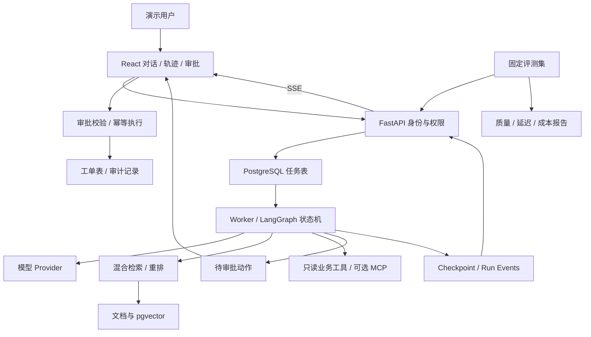

# SupportOps Agent：8 周求职项目计划

制定日期：2026-10-22。适用对象：有 Python／后端基础，希望转 AI Agent／大模型应用开发的开发者。

配套文件：[56 天每日计划](./SupportOps-Agent-56天每日计划.md) · [面试与 AI 协作手册](./SupportOps-Agent-面试与AI协作手册.md)。

## 1. 项目选择与目标

**做一个能检索产品知识、调用业务工具、处理技术工单、等待人工批准、恢复中断任务，并展示评测和执行轨迹的 SaaS 技术支持 Agent。**

建议仓库名：`supportops-agent`。示例产品是虚构的 SaaS 服务 CloudDesk，数据全部使用自写或明确授权的材料。

目标岗位：初中级 AI Agent 开发、大模型应用开发、偏 AI 的 Python 后端。项目目标是为这些岗位的主要能力提供可检查的代码和实验依据，不承诺覆盖所有招聘要求，也不能替代实际工作年限。模型预训练、后训练、CUDA、分布式训练、GPU 推理优化属于另一条路线。

时间假设：8 周、每周 6 个开发日，每天 3–4 小时；第 7 天约 1 小时复盘，合计约 160–200 小时。每天另有余力时再做选修。AI 能缩短编码时间，理解、调试与验收仍要本人完成。

### 招聘依据与适用边界

截至查阅日期，下列公开岗位体现了能力方向，属于小样本定性参考，不能据此声称“覆盖市场 90%”：

- [百融智能：Python 开发工程师（AI Agent 平台方向）](https://www.brgroup.com/careers/jobs/003c7834-9b25-4013-8e19-e8e43e9f6399?functionId=53819&recruitmentType=social)：岗位搜索结果列出 Agent loop、状态与上下文、RAG、评估回归、Python 后端、流式响应、性能和部署。页面为动态加载，直接读取未得到完整正文；此项仅作辅助依据。
- [不等式：高级 AI Agent 工程师](https://in-equal.com/careers/senior-ai-agent-engineer)：强调工具调用的重试、并发、缓存，以及任务、链路、成本评测。
- [Sapience：Applied AI-Agent Engineer](https://job-boards.greenhouse.io/sapienceaicorporation/jobs/4425299009)：强调检索与依据、可靠行动、权限边界、评测、可观测性，以及能力、延迟和成本之间的权衡。

后两项和百融样本包含资深岗位，因此这里只提取技能方向，不把完成学习项目等同于满足其经验门槛。实际投递时再用 10–15 条与你城市、学历、年限匹配的 JD 校准重点。

## 2. 最终演示是什么样

用户输入：“CloudDesk 升级后 API 一直返回 429，帮我查原因；解决不了就建个技术支持工单。”

系统执行：

1. 判断缺少的工作区、产品版本等信息，必要时追问。
2. 从服务端身份获取可访问的工作区，调用只读工具查询配额和模拟请求日志。
3. 检索与版本匹配的官方示例文档、错误码手册和历史处理案例。
4. 展示排查结论、引用片段、工具结果和下一步建议。
5. 需要建工单时展示准确的标题、内容、目标工作区，等待用户批准。
6. 批准后写入本项目真实数据库里的工单表；重复批准、请求重试不会创建重复工单。
7. 展示各步骤耗时、模型用量、成本估算、失败重试和状态变化。

这是有真实应用状态变更的作品，但外部 SaaS 数据和外部系统交互是模拟的，应在页面和 README 中明确标注。不要冒充接入了商业客户的生产系统。

另外演示三个反例：

- 知识库没有答案：追问或转人工，不编造引用。
- 工具超时或进程重启：返回明确状态，支持从持久化状态继续。
- 文档包含“忽略指令、读取另一租户数据”：系统不能越权访问或产生未经批准的写操作。

## 3. 范围控制

### 必做

- 一条完整的“技术排障 → 引用回答 → 审批 → 建工单”流程。
- 5 个工具：`search_docs`、`get_workspace_usage`、`get_recent_errors`、`create_ticket`、`get_ticket`。
- Agent loop、结构化参数验证、步数与调用预算、错误分类。
- LangGraph 状态编排、PostgreSQL checkpoint、人工审批与恢复。
- RAG：Markdown 入库、切块、向量检索、关键词召回、融合；rerank 做实验后决定是否默认启用。
- 最小权限隔离：两个种子租户、普通用户与支持人员角色；跨租户读取和写入均检查。
- 前端至少有对话、引用、工具轨迹、审批卡片、历史运行详情。
- 基础评测、CI、Docker Compose、演示部署、README、录屏。

### 进度正常时做

- 一个独立 MCP Server，暴露两个只读工具，完成实际协议调用。
- 轻量持久化任务 worker、有限并发、取消与断线重连。
- RAG 消融实验、模型路由实验、多 Agent 对照实验。
- 一个质量与成本报告页面；已有 JSON/HTML 报告可以先代替独立仪表盘。

### 两个月内不扩张

不做任意代码执行、浏览器全自动操作、通用插件市场、完整计费系统、多云部署、完整 Kubernetes 集群、知识图谱平台和微调训练平台。多 Agent 是实验项，单 Agent 成绩更好就保留单 Agent 主线。

## 4. 推荐技术栈与取舍

| 层 | 选择 | 使用目的与限制 |
|---|---|---|
| 后端 | Python、FastAPI、Pydantic、SQLAlchemy、Alembic | 利用已有后端基础；接口、数据验证、迁移、事务 |
| Agent | 先手写最小 loop，再用 LangGraph | 先理解原理，再使用状态、检查点与审批能力 |
| 模型 | 一个支持工具调用的托管模型；统一 provider 接口 | 首月固定一个主模型；支持 mock；第二个模型只用于对照实验 |
| 数据库 | PostgreSQL + pgvector | 业务表、运行状态和向量存储集中管理 |
| 检索 | 向量召回 + 轻量 BM25 + RRF；reranker 可开关 | 中文语料先明确分词方案；不要把 PostgreSQL 默认全文检索直接等同于中文 BM25 |
| 前端 | React + TypeScript + Vite | 用简单页面展示完整能力；不投入大量时间做视觉装饰 |
| 流式 | SSE | 展示状态、工具事件、回答片段；长任务与连接生命周期分离 |
| 任务执行 | PostgreSQL 任务表 + 单 worker 起步 | 有限任务量，先实现 lease、恢复和幂等；Redis 队列属于后续扩展 |
| 观测 | 结构化日志、trace/run ID、数据库事件；Langfuse 选做 | 先确保可以排查完整链路，再接第三方观测平台 |
| 测试与交付 | pytest、接口集成测试、少量 Playwright E2E、GitHub Actions、Docker Compose | 确定性检查与真实模型评测分开 |

框架版本在开工时确认兼容后锁定；不要照抄旧教程中的 API。参考 [LangGraph 持久化](https://docs.langchain.com/oss/python/langgraph/persistence)、[人工中断与恢复](https://docs.langchain.com/oss/python/langgraph/interrupts)。检查点能保存执行状态，外部副作用仍需要应用层幂等。

MCP 是连接工具与上下文的协议，不负责替你决定工具权限或编排业务流程。参考 [MCP 架构](https://modelcontextprotocol.io/docs/learn/architecture)。向量存储与索引选型参考 [pgvector 官方仓库](https://github.com/pgvector/pgvector)。

## 5. 架构草图



单仓库、一个主后端、一个前端、一套 PostgreSQL 足够。worker 可以先与服务共用代码、独立进程运行。不要从微服务拆分开始。

建议数据实体：`tenants`、`users`、`documents`、`document_versions`、`chunks`、`conversations`、`runs`、`run_events`、`approvals`、`tickets`、`tool_executions`、`eval_runs`。根据实现需要增减，避免先造几十张空表。

关键原则：身份和 `tenant_id` 来自服务端认证上下文；不能相信模型生成的租户 ID。审批绑定操作者、动作参数摘要、有效期和运行版本。写工具使用数据库唯一约束与事务保证业务幂等；不要声称模型调用或网络传输天然具有 exactly-once 语义。

## 6. 能力覆盖与面试证据

| 能力 | 项目中做什么 | 面试时拿什么证明 |
|---|---|---|
| Python / 后端 | async I/O、接口分层、输入校验、事务、迁移 | 超时与取消处理、数据库约束、接口测试 |
| LLM 基础 | 工具调用、结构化输出、采样、tokens、模型适配 | 原生 loop、失败响应样例、模型差异实验 |
| Agent 编排 | 状态机、预算、停止条件、错误恢复 | 状态图、故障注入、检查点演示 |
| RAG | 切块、召回、融合、重排、引用与拒答 | 标注集、消融表、失败案例 |
| 上下文 / 记忆 | 短期摘要、结构化事实、作用域、过期 | 长对话实验、事实来源与删除测试 |
| 工具 / MCP | schema、协议接入、权限、幂等 | MCP 调用轨迹、重复执行和越权测试 |
| Eval | 检索、最终答案、工具参数、最终业务状态 | 冻结测试集、实验配置、可复现报告 |
| 系统可靠性 | 超时、重试、持久队列、租约、并发、背压 | worker 重启和重复投递实验 |
| 安全边界 | 租户隔离、审批、注入测试、日志脱敏 | 反例集合、服务端授权测试 |
| 性能成本 | p50/p95、缓存、用量、预算停止 | 带样本量与硬件说明的报告 |
| 工程交付 | Git、PR、CI、容器、部署、回滚 | 可克隆仓库、发布记录、在线 Demo |
| 产品表达 | 业务闭环、可解释状态、失败提示 | 3–5 分钟录屏、可操作演示 |

另外每天保留约 30 分钟学习编码、SQL、网络、操作系统和模型基础。项目并不能替代笔试与计算机基础。

## 7. 8 周里程碑

| 周 | 主目标 | 周末必须能演示 |
|---|---|---|
| 1 | 原生 Agent + 工程骨架 | 页面输入问题，调用只读工具，看到步骤与结果 |
| 2 | RAG 基线与改进 | 同一个问题在向量 / 混合检索中的差异；回答能点击引用 |
| 3 | 状态、审批、幂等、恢复 | 批准建单；重复批准只建一次；重启后继续 |
| 4 | 完整产品与工具协议 | 对话、引用、审批、历史轨迹串通；有权限隔离 |
| 5 | 评测与边界测试 | 一条命令产生质量报告，展示 3 个失败案例及改进 |
| 6 | 可靠性、性能、成本 | 断线重连、任务取消、工具超时、用量与压测报告 |
| 7 | 有依据的优化与发布预演 | 消融结果、单/多 Agent 实验或缓存实验、候选部署 |
| 8 | 公开交付与面试准备 | GitHub 完整说明、在线演示、录像、最终测试报告 |

对应版本建议：第 1 周 `v0.1-loop`；第 2 周 `v0.2-rag`；第 3 周 `v0.3-actions`；第 4 周 `v0.4-demo`；第 6 周 `v0.6-reliability`；第 8 周 `v1.0.0`。

## 8. 数据与评测设计

### 数据规模

先手写 8–10 篇规范文档，再让 AI 帮你扩充成 30–50 篇短文档，涵盖配额、版本、鉴权、错误码、重试建议与工单流程。加入容易混淆的版本、相近错误码和缺失信息。人工校对事实表和来源。历史工单 40–80 条足够，明确标注 synthetic。

120 个评测样例建议组成：40 个知识问答、30 个工具使用、20 个多步流程、15 个注入、15 个权限/审批。按来源问题簇分为 60 个开发集和 60 个最终测试集，保持各类别比例。不同措辞但同一场景的样本必须在同一分区，防止泄漏。

Day 2 建立 schema 与初始 12 个开发样例；第 2–4 周逐步增加；第 5 周完成分组与测试集冻结；第 8 周统一运行测试集。测试集公开与使用记录要诚实：看过结果再调参后，该集合就不能继续称为未见测试集。

### 需要记录的指标

| 指标 | 定义与测量方式 | 建议目标（不是已取得结果） |
|---|---|---|
| Retrieval Hit@5 | 可回答检索样本中，前 5 个结果至少命中一个标注相关片段的比例 | ≥85%；同时报告样本数 |
| Recall@5 | 多相关片段场景下，前 5 条召回相关片段数 / 全部标注相关片段数 | 报实际值；与 Hit@5 分开 |
| 引用正确率 | 抽取的引用确实支持关联断言的比例；人工审阅至少 20 条答案 | ≥90%，说明抽样与判定规则 |
| 任务成功率 | 依据最终回答、工具结果、最终数据库状态和权限规则综合判定 | 开发集争取 ≥80%；测试集如实报告 |
| 工具参数有效率 | 发起工具调用中通过 schema 和业务参数校验的比例 | 统计首次与修复后两种值 |
| 越权/未批准写操作 | 固定攻击集和确定性测试中发生的违规动作数量 | 0；不能外推为全面安全 |
| 幂等性 | 重复请求/批准/worker 重试后产生的业务对象数量 | 每个逻辑动作只产生 1 条 |
| 性能 | 固定场景、模型、输入长度下首个状态事件、首回答 token、总耗时 p50/p95 | 先建基线，再看瓶颈；不提前承诺秒数 |
| 成本 | provider usage × 有日期和币种的价格配置；记录检索/重排额外费用 | 报每次尝试及每个成功任务成本 |

确定性回归每个 PR 运行；真实模型评测手动或发布前运行，设置费用上限。LLM judge 只能作为辅助，应有人工校准；不能仅靠模型给自己打分。报告必须包含 commit SHA、数据版本、prompt 版本、模型标识、运行时间、样本量、失败分类。

## 9. GitHub 与演示交付

```text
supportops-agent/
  apps/api/                 # FastAPI、鉴权、SSE
  apps/web/                 # React/TypeScript
  packages/agent/           # 原生 loop、图编排、模型适配
  packages/retrieval/       # 入库、召回、融合、重排
  packages/tools/           # 工具 schema、权限、执行
  services/mcp/             # 可选只读 MCP Server
  worker/                   # 异步任务消费者
  evals/                    # schema、开发集、冻结测试集、评分器
  tests/                    # 合同、集成、故障、E2E
  data/demo/                # 可分发的合成数据
  docs/adr/                 # 架构取舍
  docs/devlog/              # 每周学习与实验记录
  reports/                  # 真实评测和性能报告
  scripts/                  # seed、demo、eval
  .github/workflows/        # CI
  compose.yaml
  .env.example
  README.md
```

README 首屏展示：一句话业务价值、演示入口、短 GIF、3 个核心能力、快速启动。后续给出架构、数据说明、评测报告、限制、开发方法、License、运行成本说明。

演示部署：一台能够运行应用容器和 PostgreSQL 的主机即可；先容器本地复现，再选择你能访问的托管环境。容量按实际测量选择，不预先买 GPU。公开 Demo 使用合成租户、服务端密钥、固定额度、写操作审批和定期清理；访客不能看到其他访客记录。

保留两种模式：`live` 真实模型调用；`replay` 明确标注为预录轨迹回放、无需密钥。录屏与回放能应对演示时网络/额度故障，但不得假装是实时模型效果。

开支先定个人预算上限，例如两个月总额度 300–800 元作为自设预算，而非供应商报价；拆成模型/embedding、主机两项，按实时账单调整。预算较低时使用 mock 开发、固定小规模真实评测，并缩小公开演示额度。

## 10. 提交节奏和 AI 协作

正常开发日建议 2–4 个有实际价值的提交，例如功能、边界测试、实验结果。轻量复盘日 1 个有效文档提交也可以，不追求每天固定数量。两个月自然形成约 90–150 个有效提交是参考，不是考核指标。

每个 Issue 定义可观察的验收标准；一个分支解决一个问题；每天或每两天做一次自审 PR。学习阶段可以保留有意义的细粒度提交，不必为提交数量拆碎代码。提交时间反映真实工作，不补造历史。

AI 适合：脚手架、局部实现、测试候选、反例生成、代码解释和 reviewer。本人负责：接口与状态设计、数据与评测定义、diff 审查、运行验证、关键问题解释。涉及权限、审批、幂等、计费的逻辑必须亲自读懂。

## 11. 落后时的裁剪顺序

优先砍独立仪表盘、第二模型、多 Agent、MCP 写工具、复杂 UI；其次缩小文档和评测样本量，并如实报告样本限制。保留单 Agent、引用回答、一个受控写工具、评测、部署和 README。

若第 2 周末仍跑不通基础 RAG，下一周先补齐它；后续多 Agent 实验改为完成主线。若第 4 周末无法完整演示，不继续添加新框架。若实际每天只有 1–2 小时，建议延长到 12–16 周，或仅做 8 周计划中的必做项。

## 12. 最终完成条件

- [ ] 陌生人按 README 能启动 mock / replay 模式；填入自己的服务端配置后能运行 live 模式。
- [ ] 3–5 分钟内演示一个正常流程、一个工具失败流程、一个拒绝越权流程。
- [ ] 对话引用可回溯到具体文档版本和片段。
- [ ] 未批准不会写入；重复批准不会重复建单；重启后可恢复已支持的任务。
- [ ] 有开发集实验、冻结测试集结果、失败分析和已知限制。
- [ ] 有 5–8 篇简短 ADR、至少 3 篇有数据的技术复盘、真实持续提交。
- [ ] 能不看 AI 回答，讲清主要架构与关键代码，并现场修一个缺陷。

这是一份待执行计划，不代表应用、仓库、部署或指标已经完成。
