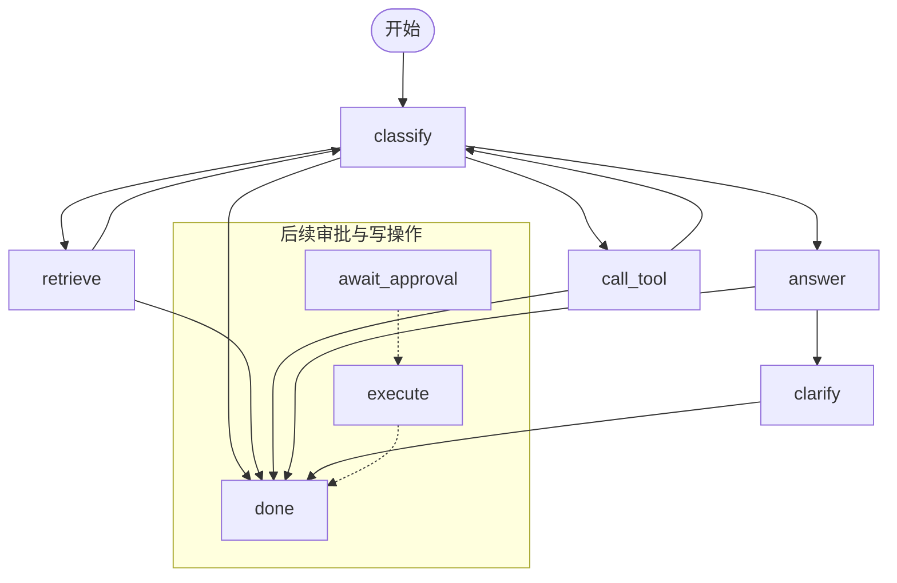

# Day 15 显式状态机

2026-11-11，北京时间。基线提交 `4adfbbd`。Day 14 网页运行使用原生循环处理只读 429 排障和引用问答，API 记录模型与工具事件，流程分支由循环控制。

## 最小方案与审查单元

1. 在 `packages/agent/loop.py` 提取每轮模型调用、顺序工具执行和答案校验。原生循环与 `scripts/agent_smoke.py` 继续作为教学对照。
2. 在 `packages/agent/graph.py` 以 LangGraph 编排已有步骤，在 `apps/api/runs.py` 切换网页运行入口，终态附带 `state_path`。依赖记录在 `pyproject.toml` 和 `requirements.lock`。
3. 在 `tests/test_runs.py` 增加状态路径回归断言，在 README、范围说明与验证报告记录行为及复现方法。

`classify` 校验模型结果，纯文档检索批次走 `retrieve`，其余工具批次走 `call_tool`。`answer` 校验回答与证据，缺产品版本时进入 `clarify` 并结束当前运行。审批与执行留待后续计划。

## 验收与实测

- 429 排障经 API 终态显示 `classify → call_tool → classify → answer → done`，保留两次工具调用、四条事件和 60/60 的合成用量。
- 缺版本的文档问题工具调用为 0，路径为 `classify → answer → clarify → done`。模拟模型超时走 `classify → done`，返回失败原因和空答案。
- 本机 PostgreSQL 上通过 ASGI 实测两条 2.0 问答，两条均走 `classify → retrieve → classify → answer → done`。配额问题返回 `quotas#limits`，退款问题提示依据不足且引用为空。
- 71 项离线测试与 20 项 PostgreSQL 集成测试通过，`pip check` 通过。原生循环的步数与工具预算回归随离线门禁执行。

## 复现与失败边界

安装锁定依赖后运行 `python scripts/check_offline.py`。显式设置专用 `TEST_DATABASE_URL`（库名以 `_test` 结尾），运行 `python -m unittest discover -s tests/integration -v`。按 README 准备本地合成文档并用 mock 完成入库。向 `POST /runs` 分别提交两条报告中的问题，设置 `knowledge: true` 和 `product_version: "2.0"`，轮询 `GET /runs/{id}`，核对终态的 `state_path`、`reason` 与 `citations`。

最可能的边界是模型重复提议相同调用、触及步数或工具预算、工具超时，以及本机数据库或适用版本文档未就绪。原有验证与终止逻辑由两种入口共用。图额外配置递归上限。运行记录仍在内存，服务关闭可终止任务，终态路径可能为空。LangSmith 跟踪在图调用时关闭。生成和文档向量使用 mock，本轮验证使用真实本地 PostgreSQL。

[实测记录](../../reports/day-15-validation.json) · [LangGraph Graph API](https://docs.langchain.com/oss/python/langgraph/graph-api)
