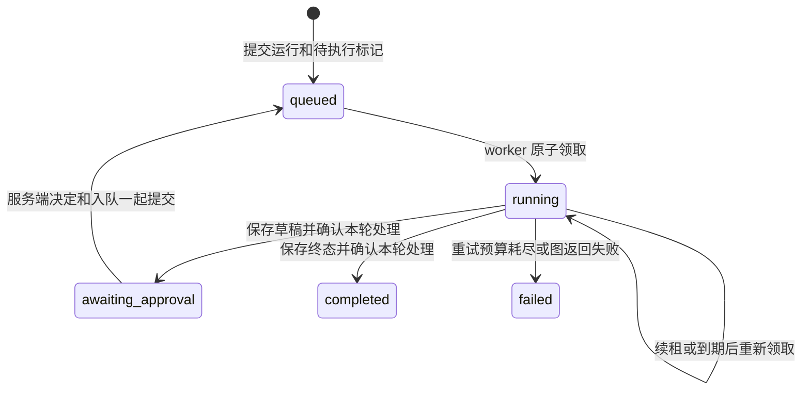

# Day36 · 持久化任务 worker

北京时间 2026-11-26。开始时本地与 GitHub main 均为 `82a4cd5`，Day35 的 `v0.5-eval` 已发布。原有 API 先保存运行归属和输入，再在 HTTP 服务进程中用 asyncio 启动图。数据库保留检查点，服务终止后的运行需要人工重新调度。

## 三组独立审查的改动

1. 新增 Alembic 迁移 `0008_run_worker`，给 `agent_runs` 增加待执行标记、领取次数、租约及部分索引。API 在同一个事务中提交运行和任务。审批决定与新一轮执行也在同一个事务中提交。
2. `packages/agent/run_queue.py` 和 `apps/api/worker.py` 用现有 PostgreSQL 从独立进程领取、续租、执行和恢复。复用图检查点、所有者校验、按运行的咨询锁、审批摘要和数据库工单回执。Compose 启动一个 worker。
3. 增加真实 PostgreSQL 和进程终止回归。既有 ASGI 测试与 Day21／Day34 脚本显式运行同一 worker 循环。README、本文和验证 JSON 记录部署、复现和故障边界。

## 五项可观察验收

- 无 worker 时，`POST /runs` 返回 202 和 `queued`。断开 HTTP 客户端并重启 API 生命周期，原 ID 仍可读且任务待执行。
- 两个并发领取只有一个拿到租约。活跃 worker 在模型阻塞期间实际续租，进程被终止后，新进程用原 ID 接手并完成。
- 旧租约不能续租或发布结果。连续三次领取失败后，下一次扫描将运行标记为 `worker_retry_exhausted`。
- 审批已写入但入队失败的模拟故障会回滚审批。重试批准后，真实数据库只增加一个工单和一条执行回执。审批、断连重试、写入幂等回归通过。
- 明细及 SSE 仍按所有者校验，正常执行时逐步发布运行快照。恢复从图检查点重新投影，最终事件序列完整。

## 队列与恢复



数据库时间决定 15 秒租约，worker 每 5 秒续租，一次只执行一个任务。领取和续租是短事务，图执行沿用咨询锁。worker 崩溃时锁随连接关闭，租约到期后同一任务可重领。工作进程用每次重新领取生成的 UUID 限制结果写入。崩溃可重放尚未检查点化的步骤，已批准动作由唯一执行回执和事务防止重复建单。

最主要的边界是审批与入队分离、旧 worker 在租约到期后覆盖结果，以及模型产生答复后、提交终态前崩溃。快照事件跟随检查点恢复，过期连接可能遇到历史回退并重新查询。Day38 再引入可跨重连使用的持久游标。迁移前的运行保持可查，未完成的旧记录可由原所有者显式恢复。本轮使用单 worker 和既有 mock；全局队列与用户级的可配置背压、取消和总时限留到 Day37。

## 实测

- 最终本地离线套件 127 项通过（72.458 秒），真实 PostgreSQL 集成套件 54 项通过（83.046 秒）。其中三个 worker 专项覆盖实际进程终止、租约竞争与重试耗尽、审批和入队事务回滚。
- 进程恢复用合成故障夹具缩短首个 worker 租约至 2 秒。观察到一次真实续租后结束该进程。新进程通过正式 worker 入口完成同一运行，领取计数由 1 增至 2，最终记录 2 次 mock 模型调用、2 次合成工具调用和 8 个事件，无剩余租约。
- 阻断审批入队时 API 返回 500，数据库审批仍为 pending。解除阻断并重试批准后，工单和执行回执各一条。既有提交后断连重试、并发写入和回滚测试均通过。
- Compose 配置检查通过。Day34 开发集重跑仍为 29/60，模型行为失败 25 条、覆盖缺口 6 条。真实模型请求为 0。

## 复现

```powershell
# TEST_DATABASE_URL 指向专用 PostgreSQL _test 库，须有 pgvector
python -m unittest discover -s tests/integration -v -k test_run_worker
python -m unittest discover -s tests/integration -v
python scripts/check_offline.py
# 在全新的输出目录保存重跑结果
python -m scripts.evaluate_day34 --output-dir "$env:TEMP/supportops-day36-dev"
docker compose config --quiet
```

持久模式的手工部署顺序与检查方式见 [README](../../README.md)。[实测 JSON](../../reports/day-36-validation.json)
